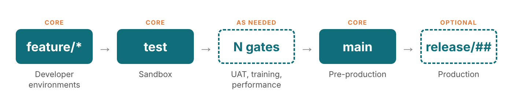

At Community Summit North America 2026, Cody Polodna and I presented *Do You Git It? Migrating D365 F&O from TFVC to Git*. We opened by asking the room three questions: who's still on TFVC, who's already on Git, and who's somewhere in between. Wherever you landed, this post is for you.

This is the strategy view: the decisions that shape everything else. Over the next few posts I'll go deep on each piece with step-by-step instructions.

## The scenario

Most teams I talk to are in one of two places:

- **Starting fresh.** A new D365 F&O implementation, a new team, or a new codebase, and you get to pick source control from day one.
- **Running on TFVC.** It works, but you're wondering whether to move, when, and how much pain it will be.

If you're starting fresh, skip the migration sections. Repo structure, branching, and pipelines apply to you just the same, and you get to do them right the first time.

## Why Git, and why now

The platform is moving:

- **Microsoft is signaling.** Microsoft moved Windows to Git. That tells you where investment is headed.
- **No new tricks for TFVC.** It's supported, but it's not where new features are going.
- **UDE changes the game.** The unified developer experience means developing locally and deploying to the cloud, a workflow that's made for Git.
- **TFVC isn't dead.** If it works for your team, you're not doing it wrong.

## TFVC vs Git at a glance

Here's how the two compare on the things that matter day to day for an F&O team, from how you branch and review code to how well each fits the unified developer experience.

| | TFVC | Git |
|---|---|---|
| Model | Centralized, one server | Distributed, local repos |
| Branching | Heavier, folder-based | Lightweight and fast |
| Merging | Often in bulk or cherry-picking | Small and frequent via pull requests |
| Code review | Optional add-on | Built into the workflow, plus AI |
| Offline work | Limited | Full history locally |
| Separating codebases | One repo per project, split by folders | Many repos, each with its own history |
| Large binaries | Handles well | LFS or artifact feeds recommended |
| Learning curve | Simpler | Steeper at first |
| Fit with UDE | Works | Natural fit |
| Future investment | Maintenance mode | Active |

## Two decisions to make first

Answer these two and the rest falls into place.

### 1. How much history do you bring?

| | Clean cutover | Recent history | Full history |
|---|---|---|---|
| Tool | Import tool, no history, or manual migration | Import tool, up to 180 days | Git-TFS |
| Effort | Lowest | Low | Highest |
| Support | Microsoft | Microsoft | Community only |
| Best for | Most teams | Teams wanting recent context | Strict audit needs |

**My recommendation: a clean cutover** (a "tip" migration). Microsoft recommends not migrating history, and it's the same approach Microsoft took moving Windows to Git. Keep TFVC read-only for reference, and you lose nothing. Before you sign up for the full-history route, ask honestly: do you really need to bring that history over?

### 2. How many repos?

**One repo, mostly.** Your X++ models compile together and ship as one package, so they belong together:

```text
F&O repo (X++)
├── Metadata/    all X++ models
├── Projects/    Visual Studio projects
└── Pipelines/   YAML build and deploy

Azure repo
├── Functions/   integrations
├── LogicApps/   workflows
└── Pipelines/   its own pipelines
```

Integrations built on Azure get their own repo, with their own history, pipelines, and reviewers. The rule of thumb: split only when lifecycle, language, or access truly differ.

## What the migration actually takes

1. **Prep.** Pick your source branch, set a code freeze, and start Git training early.
2. **Clean up.** Remove binaries and build output, move ISV binaries to an artifact feed, and turn `.tfignore` into `.gitignore`.
3. **Migrate.** Clean cutover, recent history (180 days or less), or full history with Git-TFS.
4. **Set up Git.** Repo structure, branch policies, and work item linking.
5. **Reconnect.** Point Visual Studio at Git and repoint your pipelines.
6. **Go live.** Run a validation build, lock TFVC read-only, and switch the team over.

> **This assumes a code freeze.** In-flight work across TFVC branches doesn't come along. Move it manually, change by change, after the migration.

## Developer setup

Getting a developer working against the new repo is three steps:

1. **Clone** the repo to your machine.
2. **Configure metadata:** set your custom metadata folder to the repo's `Metadata` folder.
3. **Build and deploy** to your developer environment.

Keep build output, IDE files, and generated D365 files out of the repo. Here's a `.gitignore` based on one from a real project, with the client- and model-specific entries removed:

```gitignore
# Binaries and build artifacts
*.dll
*.pdb
*.exe
bin/
XppMetadata/
Resources/

# Log files
*.log

# User-specific or temporary files
.vs/
.suo
*.user
*.bak
*.tmp
temp/

# Dynamics 365 generated files
*.cache
*.xref
*.rdl
*.BCL
ABP.ElementNames.xml

# Build results, at any folder depth
**/BuildModelResult.xml
**/BuildModelResult.err.xml
**/BuildProjectResult.xml
**/BuildProjectResult.err.xml
**/CompileLabels.xml

# AI assistant instructions (keep local)
**/.github/copilot-instructions.md
```

Ignoring `*.dll` is the right default, but some models need specific DLLs checked in, like a .NET library your X++ references. Re-include just those with a negated pattern:

```gitignore
!YourModel/bin/
YourModel/bin/*
!YourModel/bin/YourCompany.*.dll
```

The order matters: un-ignore the folder, ignore everything in it, then un-ignore only the files you need.

One watch-out: switching Git branches can leave your environment out of sync with your code. Redeploy after switching.

## A branching strategy built for F&O

Start with general Git hygiene that works for any team:

- **One branch per story.** Small, focused, short-lived.
- **A pull request for every merge.** Code review, built in.
- **Build validation.** Catch compile errors before they land.
- **Protect key branches.** No direct commits to test or main.

Then map branches to environments:



Every team needs the core three: **feature → test → main**. Add a branch only for an environment that needs its own gate, such as UAT, training, or performance testing. Start with three. No environment? No branch.

### When production needs a fix

1. Branch the hotfix off `main`.
2. Validate it in a sandbox, then deploy to production.
3. Merge it back down through every layer to `test`.

A fix that isn't merged back down is a bug waiting to come back.

### Watch-outs

- **Selective promotion.** If only some stories pass UAT, environment branches push everything. Plan for cherry-picks, or promote from feature branches (with a test pass first).
- **One Version updates.** These are platform updates, not code. Validate them in a sandbox against your branches before production updates.

The goal: your branches should tell you exactly what's running where.

## Shipping it: pipelines as code

Move from classic build definitions to YAML pipelines that live in the repo. A simplified example:

```yaml
trigger:
  branches:
    include: [ test, main ]
pr:
  branches:
    include: [ test ]

pool:
  vmImage: windows-latest

steps:
- task: NuGetCommand@2         # restore F&O build packages
- task: VSBuild@1              # compile X++
- task: XppCreatePackage@2     # deployable package
- task: PublishPipelineArtifact@1
```

Three things to notice:

- **No build VM.** The compiler comes from NuGet packages.
- **Branch triggers.** CI on your environment branches, PR builds into `test`.
- **Reviewed like code.** Pipeline changes go through pull requests too.

Your branch strategy and pipeline strategy are the same strategy:

| Branch | Pipeline |
|---|---|
| `feature/*` | PR validation build |
| `test` | Build and deploy to the sandbox |
| Gate branches (as needed) | Deploy with approvals |
| `main` | Final sign-off to production |
| `release/##` (optional) | Track deployments with releases |

### Don't rebuild ISVs

Your repo holds your X++ only. ISV binaries come from an artifact feed, and the build compiles just your code into a deployable package. You use fewer build minutes, and you avoid a Git-specific trap: committed binaries live in history forever and bloat every clone.

## Lessons from the field

- **Migration:** Do you really need that history? Start simple.
- **Branching:** Give developers easy-to-follow instructions. And remember, more branches mean more admin overhead.
- **Pipelines:** Get a robot to write the YAML. AI coding tools are very good at it. And if you don't want to fight with artifact feeds, use blob storage.

## What to start today

1. **Take inventory.** Branches, binaries, ISVs, and in-flight work.
2. **Make the two decisions.** How much history, how many repos.
3. **Clean up TFVC.** Binaries out, `.gitignore` ready.
4. **Map a branch to each environment.** Start with feature, test, and main.
5. **Move one pipeline to YAML.** Start small and prove the pattern.
6. **Pick your cutover date,** and plan the code freeze.

## Coming up in this series

This post is the map. Next come the hands-on guides, each with the scenario, the steps, and the gotchas:

1. **Migrating from TFVC to Git, step by step:** cleanup, the import, and locking TFVC.
2. **Repo structure and developer setup:** the metadata folder, Visual Studio, and `.gitignore`.
3. **Branching in practice:** branch policies, pull requests, hotfixes, and selective promotion.
4. **YAML pipelines for D365 F&O:** from a classic build definition to a code-based pipeline.
5. **Handling ISV binaries:** artifact feeds versus blob storage.

I'll link each one here as it's published.

Thanks to Cody Polodna for co-presenting this with me at Summit, and to everyone who came out and asked great questions. If your team is mid-migration and hitting something I haven't covered, I'd like to hear about it on [LinkedIn](https://www.linkedin.com/in/jamesptorres/).

Thanks for reading,\
James
