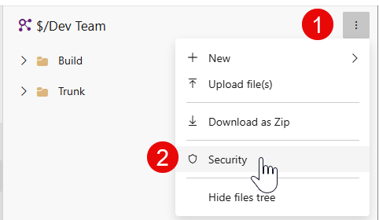
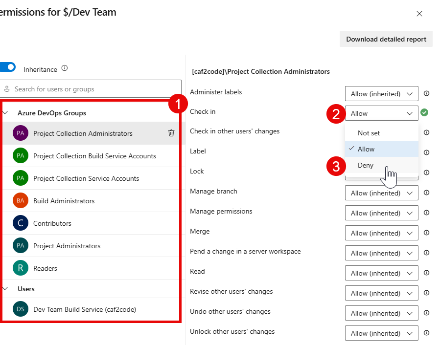
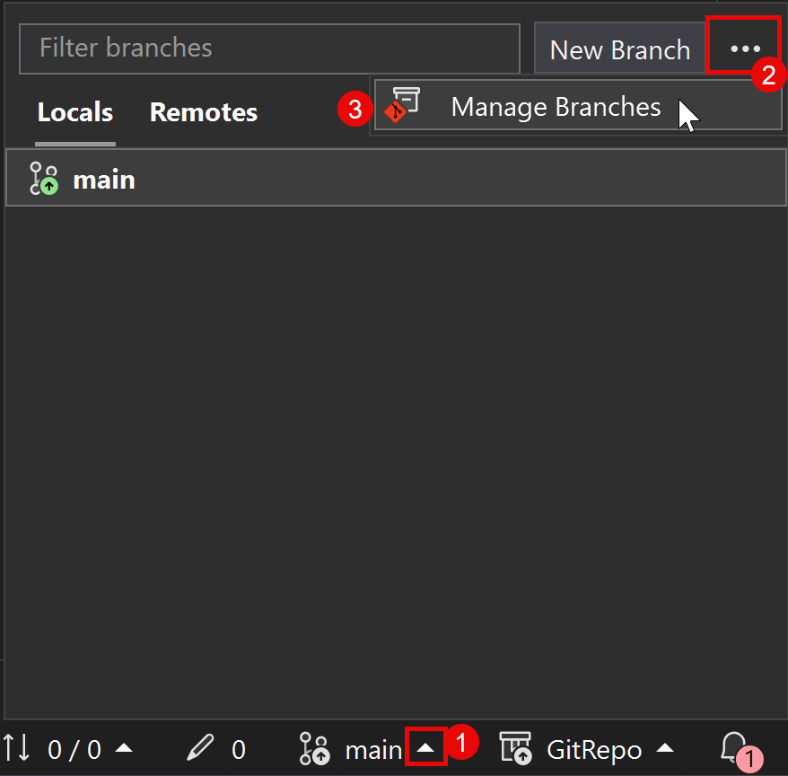
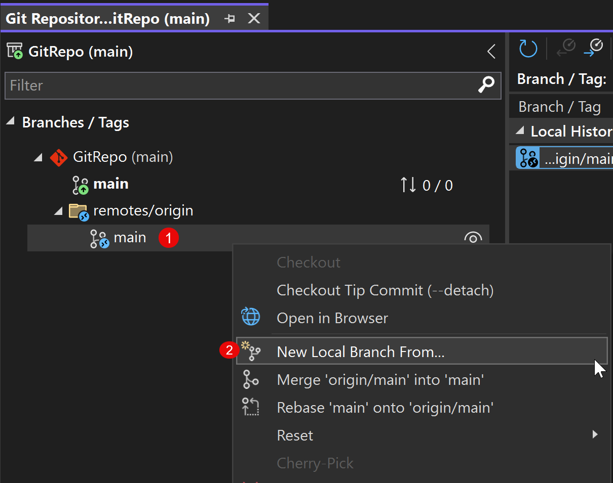
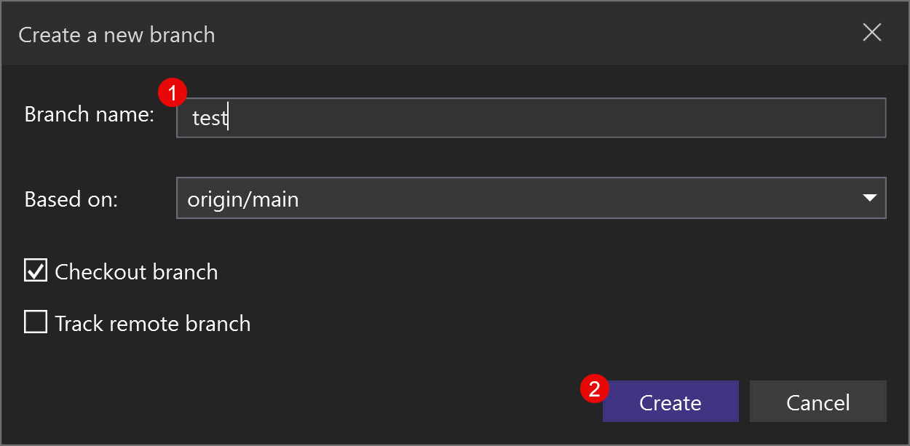

This is **Part 1** of the hands-on guides in the *Do You Git It?* series. If you haven't read the overview, start with [A Git strategy for D365 F&O teams](/blog/do-you-git-it-d365-fo-git-strategy/). It covers the decisions to make before you touch anything: how much history to bring, how many repos, and how to branch.

Here, I'll walk through the actual steps in Azure DevOps (ADO) and Visual Studio, with screenshots along the way. Part 1 gets your code out of TFVC and into Git with a clean cutover: you copy your production code into a new Git repo by hand, rather than using the import tool. It's the simplest route, and Git starts clean, with no TFVC history or old binaries carried along. Configuring the repo itself (branch security, pull requests, pipelines, and releases) comes in later parts.

> **A note on dev environments:** these steps work whether you develop on the unified developer experience (UDE) or a cloud-hosted environment, but I'm focusing on UDE. That's where Microsoft is moving F&O development, away from cloud-hosted environments.

## Step 1: Freeze and lock TFVC

Before you copy anything, stop changes from landing in TFVC.

1. **Announce a code freeze.** Agree on a cutoff with the team. After it, nobody checks in to TFVC.
2. **Lock TFVC as read-only.** Deny check-ins so the freeze is enforced, not just requested. The team can still read the code, which you'll need for the copy in Step 4 and for moving in-flight work in Step 10.

To lock it in Azure DevOps:

1. Go to **Repos > Files** and select your TFVC repo (the one starting with `$/`).
2. Open the **⋮** menu next to the repo name and select **Security**.



3. In **Permissions**, select a group.
4. Set **Check in** to **Deny**.
5. Repeat for **every group in the list**, administrators included, so nobody can check in anymore.



Leave **Read** as it is, so everyone can still see the code. Deny wins over Allow in Azure DevOps, so someone who belongs to several groups is still blocked.

Without a freeze, changes keep landing in TFVC while you migrate, and they're easy to miss.

## Step 2: Create the Git repo

How you start depends on where you're working in Azure DevOps.

### Option A: A new ADO project

A brand-new project comes with an empty repo. Before you can create branches or import code, it needs a first commit.

1. In **Repos**, go to **Branches** (or **Files**). Since the repo is empty, you'll land on the "Add some code!" page.
2. Under **Initialize main branch with a README or gitignore**, leave **Add a .gitignore** set to **None** and select **Initialize**. You'll add your own F&O `.gitignore` in a later step.


This creates the `main` branch with a single README commit.

### Option B: An existing ADO project

If your project already exists (for example, it's where your TFVC code lives today), add a new Git repo alongside it.

1. Go to **Repos > Files**.
2. In the breadcrumb at the top, open the **repository dropdown** and select **New repository**.
3. In the **Create a repository** panel:
   - **Repository type:** Git
   - **Repository name:** a name for your F&O repo
   - **Add a README:** leave this checked, so the repo starts with a first commit
   - **Add a .gitignore:** None. The built-in templates aren't built for D365 F&O, so you'll add your own F&O `.gitignore` in a later step.
4. Select **Create**. The repo is initialized with a `main` branch.


Either way, you now have a Git repo with a `main` branch, ready for the next steps.

## Step 3: Clone the repo in Visual Studio

Next, get the new repo onto your development machine.

1. Open **Visual Studio**.
2. On the start window, select **Clone a repository**.


3. In **Clone a repository**, set the **Path** to the local folder where the repo should live. Select **...** to browse to it. I use `C:\Repos\` (see the note below).
4. Under **Browse a repository**, select **Azure DevOps** to find the repo you created in Step 2.


5. In **Connect to a Project**, expand your ADO project and select the Git repo you created.
6. Confirm the **Path**. Visual Studio adds the repo name to the folder you chose.
7. Select **Clone**.


The `$/` entry under the project is your existing TFVC repo. For this step, pick the Git repo, which has the Git icon.

> **Where to clone:** the most important rule is to keep the repo **out of any OneDrive-synced folder**. OneDrive can lock files and fight with Git over thousands of small metadata files. I use `C:\Repos\<RepoName>`, and another drive such as `D:\Repos\` works just as well. A short path also keeps you clear of Windows' 260-character path limit, which deep X++ metadata folders can hit.

## Step 4: Set up the folders and copy your models and projects

With the Git repo cloned, bring your code over from TFVC.

1. In the root of your cloned Git repo, create two folders: **`Metadata`** and **`Projects`**.
2. Open your **TFVC workspace folder** for the branch that matches **production**, the local folder that workspace maps to.
3. Copy the folders for **only the models you want under source control** into the new `Metadata` folder.
4. Copy your **Visual Studio projects** from the TFVC workspace into the new `Projects` folder, so the team keeps the projects they work in.

Your repo should now look like this:

```text
C:\Repos\<RepoName>
├── Metadata/
│   ├── YourModel/
│   └── YourOtherModel/
├── Projects/
│   └── YourProject/
└── README.md
```

> **Start from production.** The copy should be your production code base in TFVC, so `main` in Git matches what's running in production. Work that's still moving through your environments doesn't come along here. You'll bring it over in Step 10.

Copy each model and project folder as is, everything included. Build output and other files that don't belong in source control get filtered out by the `.gitignore` in the next step. Copy your own models and your ISV models. Microsoft's standard packages stay out of the repo.

Git doesn't track empty folders. If you have no projects to copy yet, add an empty file named `.gitkeep` to `Projects` so the folder still makes it into the repo.

> **ISV models, for now.** Bringing ISV models into the repo keeps the migration simple and gets everything building from one place. There are more efficient ways to manage them, and I'll cover those in a later post in this series.
>
> One catch: some ISVs ship models as compiled DLLs only, and the `.gitignore` in the next step ignores every `*.dll` and `bin/` folder. For those models, re-include the DLLs as shown in Step 5, or they won't make it into Git.

## Step 5: Add the .gitignore

Before you commit anything, add a `.gitignore` so build output, binaries, and user-specific files never make it into Git.

1. In the **root** of the repo (the same level as `Metadata` and `Projects`), create a file named **`.gitignore`**.
2. Paste in the contents below and save.

> **Tip:** File Explorer can be fussy about names that start with a dot. In Notepad, choose **Save as**, set **Save as type** to **All files (\*.\*)**, and name the file `.gitignore`. Otherwise you may end up with `.gitignore.txt`.

```gitignore
# Binaries and build artifacts
*.dll
*.pdb
*.exe
bin/
XppMetadata/
Resources/

# Log files
*.log

# User-specific or temporary files
.vs/
.suo
*.user
*.bak
*.tmp
temp/

# Dynamics 365 generated files
*.cache
*.rdl
*.BCL
ABP.ElementNames.xml

# Build results, at any folder depth
**/BuildModelResult.xml
**/BuildModelResult.err.xml
**/BuildProjectResult.xml
**/BuildProjectResult.err.xml
**/CompileLabels.xml

# Model-specific rules (uncomment and edit as needed)
# Ignore a custom model's cross-reference file:
# /**/<ModelName>.xref
# Re-include DLLs a model needs (the order matters):
# !Metadata/<ModelName>/bin/
# Metadata/<ModelName>/bin/*
# !Metadata/<ModelName>/bin/<DllName>.dll
```

A few notes on this file:

- **Generic by design.** It covers the common F&O build output and user files. The commented-out lines at the bottom are placeholders for model-specific rules.
- **Model `.xref` files:** to ignore a custom model's cross-reference file, uncomment the `.xref` line and fill in the model name.
- **DLLs a model needs:** `*.dll` ignores every DLL. If a model references a .NET library that has to be checked in, or an ISV model ships as DLLs only, re-include just those files with the three commented `bin` lines: un-ignore the model's `bin` folder, ignore everything in it, then un-ignore only the DLLs you need. The order matters.

## Step 6: Build and deploy to validate

Before you commit anything, prove the repo has everything. Build the solution in your UDE or cloud-hosted development environment.

1. **Retire the TFVC copy on this machine.** If a TFVC workspace here maps the same models, remove that mapping so you build the Git copy, not the TFVC one. On cloud-hosted, the workspace usually maps straight into `PackagesLocalDirectory`, so move those model folders out before you link the Git ones in.
2. Point your development environment at the repo:
   - **UDE:** set the custom metadata folder in your metadata configuration to the repo's `Metadata` folder.
   - **Cloud-hosted:** link each model folder in the repo into `PackagesLocalDirectory`, the same way you mapped your TFVC workspace.
3. **Build** your models, then **deploy** them to the environment (on cloud-hosted, build and run a database sync).

If the build fails or something is missing in the environment, a file didn't make it over in the copy. Fix it and build again before you commit.

## Step 7: Review, commit, and push

With a clean build, make your first real commit.

1. In Visual Studio, open **Git Changes** and **review the files listed under Changes**. Make sure nothing extra is being added, like the build output from Step 6 or DLLs. If something slipped through, your `.gitignore` isn't working as expected. Fix it before you commit.
2. Enter a commit message, such as **TFVC to Git migration**.
3. Select the dropdown next to **Commit All**, then choose **Commit All and Push**.


Your production code is now in Git on `main`. Check the repo in Azure DevOps to confirm the `Metadata` and `Projects` folders and your models are there.

> **Prove it from a clean clone.** The build in Step 6 used your local folder, which still has everything. To prove what's in Git is complete, have a second developer clone the repo fresh and repeat Step 6. If something is missing, the `.gitignore` is usually filtering out a file it shouldn't. Fix it and push again.

## Step 8: Create your environment branches

With `main` validated, create the rest of your branches from it.

1. In Visual Studio's status bar, select the arrow next to the current branch name, then **...** and **Manage Branches**.



2. In the **Git Repository** window, expand **remotes/origin**, right-click **main**, and select **Fetch** to get the latest changes from the remote branch. This matters more once development starts flowing into `test` and `main`, so you never branch from a stale copy.
3. Right-click **main** again and select **New Local Branch From...**.



4. Name the branch **`test`**, confirm it's based on **`origin/main`**, and select **Create**.



5. **Push** the new branch so it's published to Azure DevOps for the rest of the team.
6. Repeat for any other environment branches your process needs, such as a UAT gate, each based on `origin/main`.

To start, every branch is an exact copy of `main`, which is your production code. From here on, day-to-day work flows into `test`, and `main` only changes when you promote to production.

## Step 9: Switch the team over

With `main` and `test` in place, move everyone to Git.

1. Each developer clones the repo (Step 3) and points their environment at it (Step 6), retiring their TFVC mapping first.
2. From here on, all new work starts as a feature branch off `test`.
3. TFVC stays read-only for reference. Nobody checks in there again.

## Step 10: Bring over in-flight development

Step 4 copied only production. Anything further down your pipeline in TFVC, such as changes in development, test, or UAT that haven't reached production, still needs to come across. With the team on Git, each developer can move their own work.

To find what's in flight, compare your TFVC development or test branch against production, or work from the changeset history since your last production release.

1. For each in-flight change, create a **feature branch off `test`**, named for the work, such as `feature/1234-short-description`. Use the same steps as Step 8, but right-click **test** under **remotes/origin** instead of **main**.
2. Copy the changed files over from TFVC into that feature branch, build, and commit.
3. Merge it into `test` through a **pull request**.
4. From there, promote it the normal way, through pull requests from one branch to the next: feature → `test` → … → `main` (production), once it's ready to deploy.

Moving changes one at a time is more work than a bulk copy, but every change lands in Git on its own, reviewed and traceable, and moves through the same path as any new work.

## What's next

That's Part 1: your code is in Git and validated, your branches are in place, the team is working in Git, and in-flight work is moving through the same path as everything else. In Part 2, I'll cover configuring the repo itself: branch security and policies so nobody commits directly to `test` or `main`, plus pipelines and releases.

