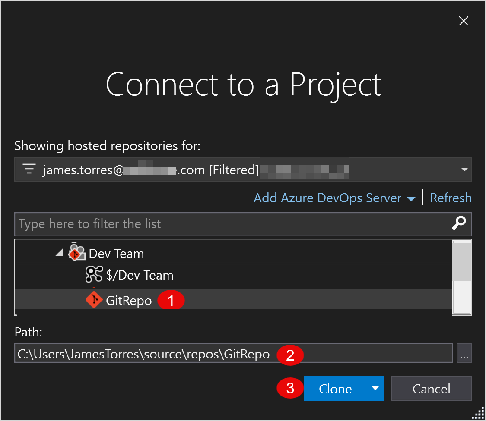

This is the first hands-on guide in the *Do You Git It?* series. If you haven't read the overview, start with [A Git strategy for D365 F&O teams](/blog/do-you-git-it-d365-fo-git-strategy/). It covers the decisions to make before you touch anything: how much history to bring, how many repos, and how to branch.

Here, I'll walk through the actual steps in Azure DevOps (ADO), with screenshots along the way.

## Step 1: Create the Git repo

How you start depends on where you're working in Azure DevOps.

### Option A: A new ADO project

A brand-new project comes with an empty repo. Before you can create branches or import code, it needs a first commit.

1. In **Repos**, go to **Branches** (or **Files**). Since the repo is empty, you'll land on the "Add some code!" page.
2. Under **Initialize main branch with a README or gitignore**, leave **Add a .gitignore** set to **None** and select **Initialize**. You'll add your own F&O `.gitignore` in a later step.

This creates the `main` branch with a single README commit.

### Option B: An existing ADO project

If your project already exists (for example, it's where your TFVC code lives today), add a new Git repo alongside it.

1. Go to **Repos > Files**.
2. In the breadcrumb at the top, open the **repository dropdown** and select **New repository**.
3. In the **Create a repository** panel:
   - **Repository type:** Git
   - **Repository name:** a name for your F&O repo
   - **Add a README:** leave this checked, so the repo starts with a first commit
   - **Add a .gitignore:** None. The built-in templates aren't built for D365 F&O, so you'll add your own F&O `.gitignore` in a later step.
4. Select **Create**. The repo is initialized with a `main` branch.

Either way, you now have a Git repo with a `main` branch, ready for the next steps.

## Step 2: Clone the repo in Visual Studio

Next, get the new repo onto your development machine.

1. Open **Visual Studio**.
2. On the start window, select **Clone a repository**.

3. In **Clone a repository**, set the **Path** to the local folder where the repo should live. Select **...** to browse to it.
4. Under **Browse a repository**, select **Azure DevOps** to find the repo you created in Step 1.

5. In **Connect to a Project**, expand your ADO project and select the Git repo you created.
6. Confirm the **Path**. Visual Studio adds the repo name to the folder you chose.
7. Select **Clone**.

The `$/` entry under the project is your existing TFVC repo. For this step, pick the Git repo, which has the Git icon.
