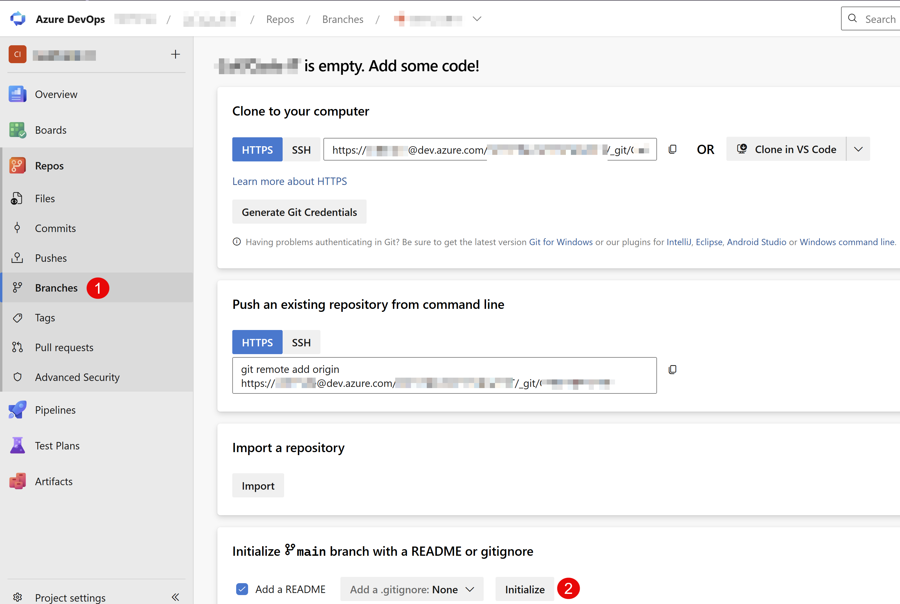
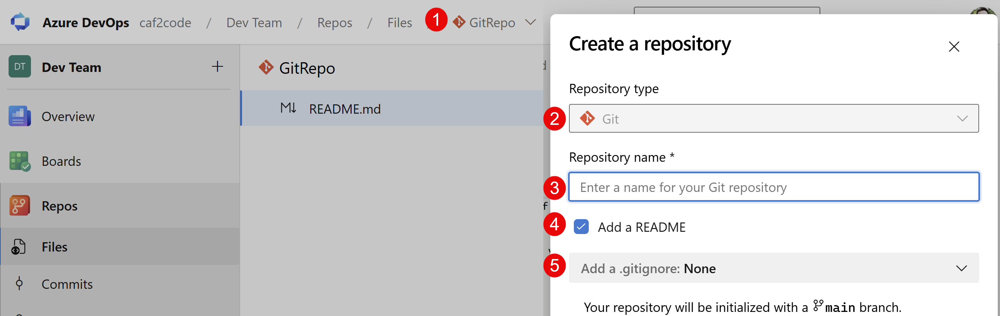
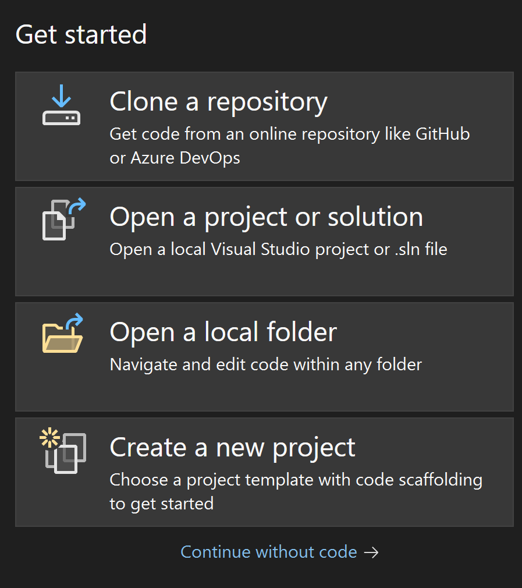
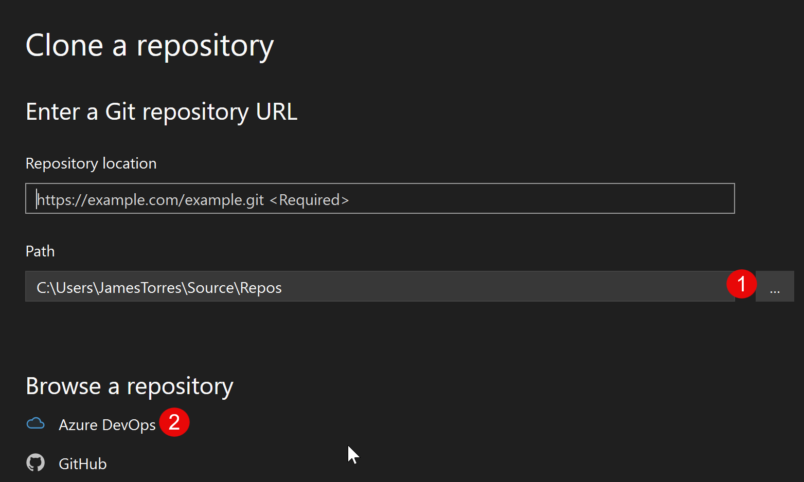
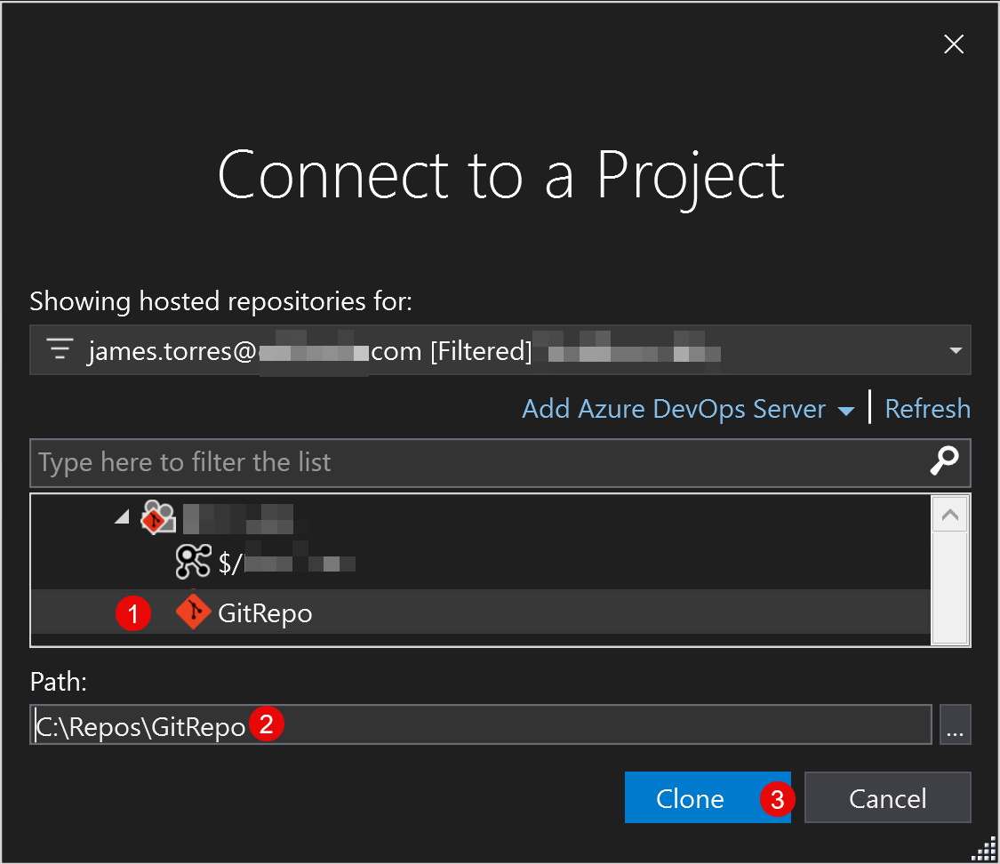
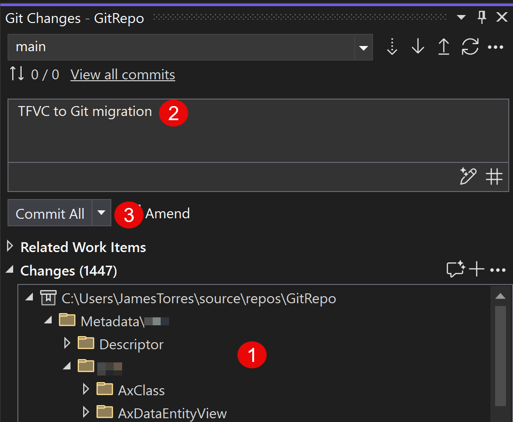

This is the first hands-on guide in the *Do You Git It?* series. If you haven't read the overview, start with [A Git strategy for D365 F&O teams](/blog/do-you-git-it-d365-fo-git-strategy/). It covers the decisions to make before you touch anything: how much history to bring, how many repos, and how to branch.

Here, I'll walk through the actual steps in Azure DevOps (ADO) and Visual Studio, with screenshots along the way.

> **A note on dev environments:** these steps work whether you develop on the unified developer experience (UDE) or a cloud-hosted environment, but I'm focusing on UDE. That's where Microsoft is moving F&O development, away from cloud-hosted environments.

## Step 1: Create the Git repo

How you start depends on where you're working in Azure DevOps.

### Option A: A new ADO project

A brand-new project comes with an empty repo. Before you can create branches or import code, it needs a first commit.

1. In **Repos**, go to **Branches** (or **Files**). Since the repo is empty, you'll land on the "Add some code!" page.
2. Under **Initialize main branch with a README or gitignore**, leave **Add a .gitignore** set to **None** and select **Initialize**. You'll add your own F&O `.gitignore` in a later step.



This creates the `main` branch with a single README commit.

### Option B: An existing ADO project

If your project already exists (for example, it's where your TFVC code lives today), add a new Git repo alongside it.

1. Go to **Repos > Files**.
2. In the breadcrumb at the top, open the **repository dropdown** and select **New repository**.
3. In the **Create a repository** panel:
   - **Repository type:** Git
   - **Repository name:** a name for your F&O repo
   - **Add a README:** leave this checked, so the repo starts with a first commit
   - **Add a .gitignore:** None. The built-in templates aren't built for D365 F&O, so you'll add your own F&O `.gitignore` in a later step.
4. Select **Create**. The repo is initialized with a `main` branch.



Either way, you now have a Git repo with a `main` branch, ready for the next steps.

## Step 2: Clone the repo in Visual Studio

Next, get the new repo onto your development machine.

1. Open **Visual Studio**.
2. On the start window, select **Clone a repository**.



3. In **Clone a repository**, set the **Path** to the local folder where the repo should live. Select **...** to browse to it. I use `C:\Repos\` (see the note below).
4. Under **Browse a repository**, select **Azure DevOps** to find the repo you created in Step 1.



5. In **Connect to a Project**, expand your ADO project and select the Git repo you created.
6. Confirm the **Path**. Visual Studio adds the repo name to the folder you chose.
7. Select **Clone**.



The `$/` entry under the project is your existing TFVC repo. For this step, pick the Git repo, which has the Git icon.

> **Where to clone:** the most important rule is to keep the repo **out of any OneDrive-synced folder**. OneDrive can lock files and fight with Git over thousands of small metadata files. I use `C:\Repos\<RepoName>`, and another drive such as `D:\Repos\` works just as well. A short path also keeps you clear of Windows' 260-character path limit, which deep X++ metadata folders can hit.

## Step 3: Set up the folders and copy your models

With the Git repo cloned, bring your code over from TFVC.

1. In the root of your cloned Git repo, create two folders: **`Metadata`** and **`Projects`**.
2. Open your **TFVC workspace folder** for the branch that matches **production**, the local folder that workspace maps to.
3. Copy the folders for **only the models you want under source control** into the new `Metadata` folder.

Your repo should now look like this:

```text
C:\Repos\<RepoName>
├── Metadata/
│   ├── YourModel/
│   └── YourOtherModel/
├── Projects/
└── README.md
```

> **Start from production.** The copy should be your production code base in TFVC, so `main` in Git matches what's running in production. Work that's still moving through your environments doesn't come along here. You'll bring it over in Step 8.

Copy each model folder as is, everything included. Build output and other files that don't belong in source control get filtered out by the `.gitignore` in the next step. Just copy your own models: Microsoft's standard packages, and ISV models you don't maintain, stay out of the repo.

## Step 4: Add the .gitignore

Before you commit anything, add a `.gitignore` so build output, binaries, and user-specific files never make it into Git.

1. In the **root** of the repo (the same level as `Metadata` and `Projects`), create a file named **`.gitignore`**.
2. Paste in the contents below and save.

> **Tip:** File Explorer can be fussy about names that start with a dot. In Notepad, choose **Save as**, set **Save as type** to **All files (\*.\*)**, and name the file `.gitignore`. Otherwise you may end up with `.gitignore.txt`.

```gitignore
# Binaries and build artifacts
*.dll
*.pdb
*.exe
bin/
XppMetadata/
Resources/

# Log files
*.log

# User-specific or temporary files
.vs/
.suo
*.user
*.bak
*.tmp
temp/

# Dynamics 365 specific files
# Descriptor files for models (if not explicitly tracking them)
# Complete directories for add-on packages (ISVs) if they are not part of your source control
# Xref files (Cross-references)

*.cache

# Addition custom model .xref files - /**/<ModelName>.xref

# Custom model .dll references
# !<CustomModel>/bin/ - Include bin folder
# <CustomModel>/bin/* - Exclude all files in bin folder
# !<CustomModel>/bin/<dllName>.*.dll - Include specific .dlls

# Dynamics 365 specific files
*.rdl
*.BCL
ABP.ElementNames.xml

# Ensure build results are caught regardless of path depth
**/BuildModelResult.xml
**/BuildProjectResult.err.xml
**/BuildProjectResult.xml
**/CompileLabels.xml
**/BuildModelResult.err.xml
```

A few notes on this file:

- **Generic by design.** It covers the common F&O build output and user files. The commented-out lines are placeholders for model-specific rules.
- **Model `.xref` files:** to ignore a custom model's cross-reference file, add a line like `/**/<ModelName>.xref`.
- **DLLs a model needs:** `*.dll` ignores every DLL. If a model references a .NET library that has to be checked in, re-include just that file with the three commented lines under *Custom model .dll references*: un-ignore the model's `bin` folder, ignore everything in it, then un-ignore only the DLLs you need. The order matters.

## Step 5: Review, commit, and push

The last step is your first real commit.

1. In Visual Studio, open **Git Changes** and **review the files listed under Changes**. Make sure nothing extra is being added, like build output or DLLs. If something slipped through, your `.gitignore` isn't working as expected. Fix it before you commit.
2. Enter a commit message, such as **TFVC to Git migration**.
3. Select the dropdown next to **Commit All**, then choose **Commit All and Push**.



Your production code is now in Git on `main`. Check the repo in Azure DevOps to confirm the `Metadata` folder and your models are there.

## Step 6: Build and deploy to your UDE environment

Before anyone starts working from the new repo, prove that it has everything.

1. In Visual Studio, connect to your **UDE environment**.
2. Point the metadata configuration at the repo's `Metadata` folder.
3. **Build** your models, then **deploy** them to the environment.

If the build fails or something is missing in the environment, a file didn't make it over, or the `.gitignore` is filtering out something it shouldn't. Fix it and push again before moving on.

## Step 7: Create your environment branches

With `main` validated, create the rest of your branches from it.

1. In Azure DevOps, go to **Repos > Branches** and select **New branch**.
2. Name it **`dev`** and base it on **`main`**.
3. Repeat for any other environment branches your process needs, such as a test or UAT gate, each based on `main`.

To start, every branch is an exact copy of `main`, which is your production code. From here on, day-to-day work flows into `dev`, and `main` only changes when you promote to production.

## Step 8: Bring over in-flight development

Step 3 copied only production. Anything further down your pipeline in TFVC, such as changes in development, test, or UAT that haven't reached production, still needs to come across.

1. For each in-flight change, create a **feature branch off `dev`**.
2. Apply the change in that feature branch and commit it.
3. Merge it into `dev` through a **pull request**.
4. From there, promote it the normal way, through pull requests from one branch to the next: feature → `dev` → … → `main` (production), once it's ready to deploy.

Moving changes one at a time is more work than a bulk copy, but every change lands in Git on its own, reviewed and traceable, and moves through the same path as any new work.

## What's next

Your code is in Git, validated, your branches are in place, and in-flight work is moving through them. In the next post, I'll cover configuring the repo itself: branch security and policies so nobody commits directly to `dev` or `main`, plus pipelines and releases.

